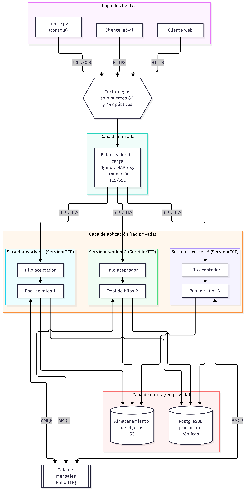

# PFO 3: Sistema Distribuido (Cliente-Servidor)

Sistema cliente-servidor sobre sockets TCP, con un pool de workers que procesa las tareas de forma concurrente.

## Arquitectura



El código de este repositorio implementa el nodo `ServidorTCP` con su pool de hilos y el cliente. Dentro de cada nodo, `queue.Queue` cumple el rol que RabbitMQ cumpliría entre servidores. El balanceador, RabbitMQ, PostgreSQL y S3 forman parte del diseño de despliegue y no están implementados en el código.

## Requisitos

- Python 3.8 o superior

## Ejecución

1. Abrir una terminal en la carpeta del proyecto e iniciar el servidor (siempre primero):

   ```bash
   python servidor.py
   ```

   Salida esperada: `[SERVIDOR] Escuchando en 127.0.0.1:5000 con 4 workers`.

2. Abrir una segunda terminal e iniciar un cliente:

   ```bash
   python cliente.py
   ```

3. Abrir una tercera y una cuarta terminal y ejecutar `python cliente.py` en cada una para simular múltiples clientes simultáneos.

4. En cada cliente, escribir una tarea y presionar Enter. El resultado llega tras 1 a 3 segundos e indica qué worker la procesó. Los clientes no se bloquean entre sí.

5. Escribir `éxito` o `exito` para cerrar la sesión del cliente. Para detener el servidor, usar `Ctrl+C`.

Si el servidor no está activo, el cliente reintenta la conexión 5 veces con 2 segundos de espera entre intentos.

## Diseño del código

| Componente | Rol |
|---|---|
| `ServidorTCP` | Hilo principal que solo ejecuta `accept()`. |
| Hilo de conexión | Productor: lee el socket en bloques de 4096 bytes, separa mensajes por `\n` y encola `Tarea`. |
| `queue.Queue` | Buffer thread-safe entre productores y consumidores. |
| Pool de workers (4 hilos) | Consumidores: extraen tareas, simulan la ejecución con `time.sleep` y responden por el socket del cliente. |
| `ClienteTCP` | Conexión con reintentos, envío de tareas en bucle y lectura del resultado. |

Protocolo: mensajes de texto UTF-8 terminados en `\n`. TCP entrega un flujo de bytes sin límites de mensaje, por eso ambos extremos acumulan datos hasta encontrar el delimitador.

## Estructura

```
.
├── servidor.py
├── cliente.py
├── Grafico.png
└── README.md
```
